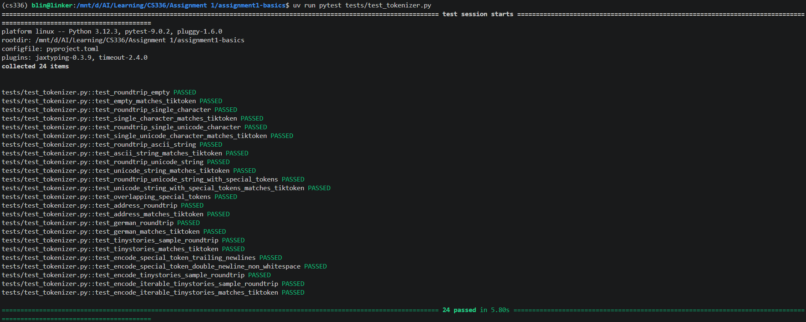

# Assignments for CS336

## assignment 1-1: Byte-Pair Encoding Vocab Training

Naive implementation is inefficient, which can be imporved by only updating the counts of the merging tokens.

My training implementation test result:

## assignment 1-2: Byte-Pair Encoding & Decoding

My encoding & decoding implementation test result:

