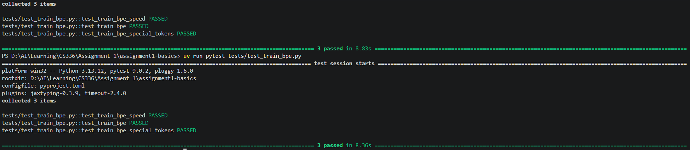

# Assignments for CS336

## assignment 1: Byte-Pair Encoding

Naive implementation is inefficient, which can be imporved by only updating the counts of the merging tokens.

My BPE implementation test result:

